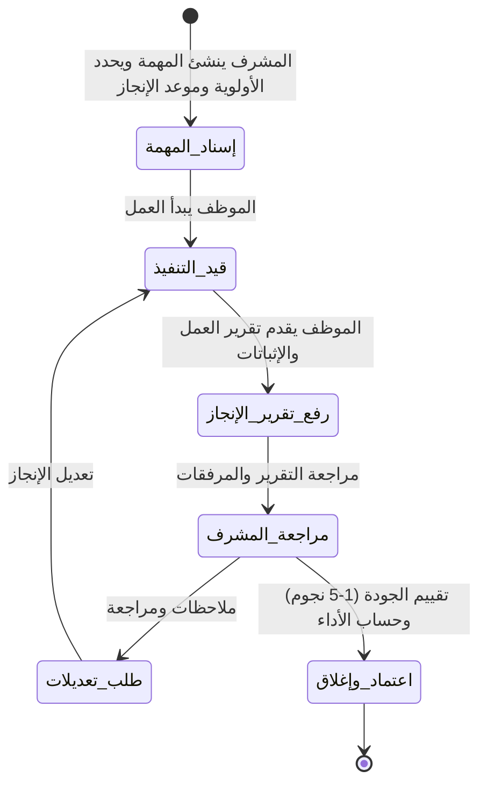

# 🏢 منصة إدارة المهام والموارد البشرية المتكاملة (HR & Task Management SaaS)
### نظام سحابي متعدد الشركات مخصص للشركات في المملكة العربية السعودية 🇸🇦

منصة متكاملة بنموذج **Multi-Tenant B2B SaaS** تجمع بين **إدارة المهام وإثبات الإنجاز (Proof of Work)** و**نظام الموارد البشرية الشامل (HRM)** المصمم خصيصاً للتوافق مع **نظام العمل السعودي، التأمينات الاجتماعية (GOSI)، ومنظومة قوى (Qiwa)، ونظام حماية الأجور (WPS)**.

---

## 📌 حالة المشروع الحالية (Project Status)
> **الحالة:** 📝 **مرحلة التوثيق والتخطيط الشامل (جاهز للبدء عند الطلب)**  
> تم تضمين كافة متطلبات الموارد البشرية السعودية وإدارة المهام دون البدء في التكويد الفعلي.

---

## 🏢 معمارية تعدد الشركات (Multi-Tenancy)
1. **عزل كامل للبيانات:** لكل شركة حساب منفصل ومعرف فريد (`company_id`)، لا يمكن لشركة الاطلاع على موظفي أو مهام شركة أخرى.
2. **تخصيص الهوية (Branding):** اسم الشركة، شعارها، ولوائح العمل والدوام الخاصة بها.
3. **هيكل الصلاحيات والأدوار:**
   - **مدير الشركة / المالك (Owner / Admin):** إدارة كاملة للشركة، الاشتراكات، اللوائح، والموظفين.
   - **مسؤول الموارد البشرية (HR Manager):** إدارة ملفات الموظفين، العقود، الرواتب، الإجازات، وضبط الحضور والانصراف.
   - **المشرف / مدير القسم (Line Manager):** إسناد المهام، متابعة الحضور اليومي لفريقه، واعتماد تقارير الإنجاز والإجازات.
   - **الموظف (Employee):** تسجيل الحضور، استعراض المهام ورفع تقارير الإنجاز، طلب الإجازات والسلف، والاطلاع على مسير راتبه.

---

## 🇸🇦 1. نظام الموارد البشرية السعودي (Saudi HR & Personnel)

### أ. ملف الموظف الرقمي الشامل (Employee Profile)
النظام يدعم التمييز الذكي بين **الموظف السعودي** و**الموظف المقيم (غير السعودي)** مع الحقول القانونية المطلوبة:

* **بيانات الهوية والإقامة:**
  - **المواطن السعودي:** رقم الهوية الوطنية (10 أرقام تبدأ بـ 1)، تاريخ الميلاد، الحالة الاجتماعية.
  - **الموظف المقيم (الوافد):** رقم الإقامة (10 أرقام تبدأ بـ 2)، تاريخ إصدار الإقامة، تاريخ انتهاء الإقامة (هجري وميلادي).
* **بيانات العمل ورخص الإقامة:**
  - **رخصة العمل (منصة قوى):** رقم رخصة العمل، تاريخ إصدارها، وتاريخ انتهاء رخصة العمل.
  - **المهنة:** حسب مسميات رخصة الإقامة والتأمينات الاجتماعية.
* **إدارة العقود (توثيق قوى):**
  - نوع العقد (محدد المدة / غير محدد المدة).
  - تاريخ بداية العقد وتاريخ انتهاء العقد.
  - فترة التجربة (90 يوماً قابلة للتمديد حتى 180 يوماً).
* **نظام التنبيهات الاستباقية للوثائق:**
  - تنبيهات آلية للمدير ومسؤول الـ HR قبل انتهاء: (الإقامة، رخصة العمل، عقد العمل، الجواز، الكارت الصحي) بـ **60 يوماً، 30 يوماً، و 15 يوماً**.

---

## ⏰ 2. الحضور والانصراف والجزاءات التلقائية (Attendance & Shifts)

### أ. ضبط الورديات وأوقات العمل (Shifts & Working Hours)
- تحديد مواعيد العمل الرسمية لكل قسم أو فرع (مثلاً: من 08:00 صباحاً حتى 04:00 مساءً).
- تحديد فترة السماح (Grace Period - مثلاً: 15 دقيقة بعد بداية الدوام).
- أيام العطلات الأسبوعية الرسمية وتوزيع أوقات دوام رمضان تلقائياً (6 ساعات عمل يومياً).

### ب. محرك الخصومات والجزاءات التلقائي (Automatic Deductions Engine)
ربط الحضور مباشرة بمسير الرواتب وفق لائحة تنظيم العمل السعودية:
1. **التأخير الصباحي (Late Arrival Penalty):**
   - تأخير بعد فترة السماح حتى 15 دقيقة: (إنذار / خصم نسبة محددة من أجر اليوم).
   - تأخير من 15 إلى 30 دقيقة: خصم ربع يوم عمل.
   - تأخير من 30 إلى 60 دقيقة: خصم نصف يوم عمل.
   - تأخير يتجاوز 60 دقيقة: خصم أجر يوم كامل مع اعتبار الموظف غائباً إن لم يحضر.
   - تكرار التأخير شهرياً يتم تصعيده آلياً حسب اللائحة الداخلية للشركة.
2. **الانصراف المبكر (Early Departure Penalty):**
   - الخروج قبل موعد نهاية الوردية بدون إذن مسبق معتمد يطبق عليه خصم يعادل ساعات الغياب أو نسبة من أجر اليوم.
3. **الغياب بدون إذن (Unexcused Absence):**
   - خصم أجر أيام الغياب الفعلية تلقائياً مع التنبيه بإنذار الفصل التراكمي حسب نظام العمل.

### ج. طرق تسجيل الحضور والانصراف:
- تسجيل الحضور عبر الويب أو الهاتف مع قفل النطاق الجغرافي للفرع (**Geofencing / GPS**).
- إمكانية الربط مع أجهزة البصمة البيومترية (ZKTeco وغيرها) عبر API.

---

## 💰 3. الرواتب، التأمينات الاجتماعية، والسلف (Payroll, GOSI & Advances)

### أ. هيكل الراتب المفصل (Salary Breakdown)
- **الراتب الأساسي (Basic Salary).**
- **البدلات الثابتة:** بدل سكن، بدل نقل، بدل اتصال، بدلات طبيعة عمل.
- **المكافآت والحوافز الإضافية.**

### ب. خصم التأمينات الاجتماعية (GOSI Deductions)
احتساب آلي فوري لنسب المؤسسة العامة للتأمينات الاجتماعية:
- **الموظف السعودي:**
  - خصم حصة الموظف من الراتب المسجل بالتأمينات (أساسي + بدل سكن).
  - احتساب حصة الشركة (صاحب العمل) تلقائياً لعرض التكلفة الإجمالية للموظف.
  - دعم اشتراك نظام ساند (ضد التعطل عن العمل).
- **الموظف غير السعودي (المقيم):**
  - احتساب فرع الأخطار المهنية (2% تتحملها الشركة بالكامل ولا يُخصم من راتب الموظف).

### ج. نظام السلف المالية (Employee Advances / Loans)
- الموظف يقدم طلب سلفة من حسابه (تحديد المبلغ، السبب، وعدد أشهر السداد).
- موافقة مدير الـ HR والمدير المالي.
- **الخصم التلقائي:** يقوم النظام آلياً باقتطاع القسط الشهري المعتمد من مسير راتب الموظف حتى اكتمال السداد، مع منع تجاوز الحد النظامي لنسبة الخصم من الراتب.

### د. مسير الرواتب ونظام حماية الأجور (WPS & Payslips)
- استخراج مسير الرواتب الشهري النهائي بضغطة زر (الراتب الإجمالي - خصم التأمينات - خصم السلف - خصومات التأخير والغياب + المكافآت).
- توليد ملف الرواتب بصيغة البنوك السعودية المعتمدة (**WPS SIF File**) للتحويل البنكي الفوري.
- قسائم رواتب رقمية (Digital Payslips) يستلمها الموظف في حسابه بصيغة PDF.

---

## 🏖️ 4. نظام الإجازات (Leave Management)
- **رصيد الإجازات السنوي:** احتساب الاستحقاق آلياً (21 يوماً للسنوات الخمس الأولى، و 30 يوماً لمن أمضى 5 سنوات فأكثر وفق المادة 109).
- **أنواع الإجازات النظامية:**
  - إجازة سنوية اعتيادية.
  - إجازة مرضية (بتقارير منصة صحتي، ومدرجة بالخصم المتدرج: بأجر كامل، بثلاثة أرباع الأجر، بدون أجر).
  - إجازات المناسبات الخاصة (وفاة، زواج، مولود جديد، حج، إجازة وضع للأمهات).
- مسار موافقات آلي يبدأ من المشرف المباشر حتى الـ HR مع تعديل رصيد الحضور تلقائياً.

---

## 📋 5. نظام المهام وإثبات الإنجاز (Task & Proof of Work Engine)

النظام يربط بين إنجاز الموظف لمهامه اليومية وتقييم أدائه الوظيفي:


### مكونات تقرير الإنجاز لكل مهمة:
1. **بيان الإنجاز الفعلي:** ماذا أنجز الموظف بالتفصيل.
2. **ساعات العمل المستغرقة:** مقارنة بالوقت المتوقع.
3. **ملفات الإثبات والمرفقات:** مستندات، فواتير، صور من الموقع الميداني، ملفات Excel، روابط تسليم.
4. **المعوقات والملاحظات:** توثيق أي عقبات واجهت الموظف.

---

## 🗄️ 6. المخطط الموسع لقاعدة البيانات (Database Schema Overview)

```text
├── companies (id, name, commercial_reg, logo, settings, gosi_code)
├── users / employees (
│     id, company_id, full_name, email, role, nationality_type ['saudi', 'expat'],
│     national_id, iqama_number, iqama_issue_date, iqama_expiry_date,
│     work_permit_number, work_permit_expiry_date,
│     contract_type, contract_start_date, contract_expiry_date,
│     department_id, job_title, basic_salary, housing_allowance, transport_allowance, other_allowance,
│     gosi_number, is_active
│   )
├── shifts (id, company_id, name, start_time, end_time, grace_period_minutes)
├── attendance_records (
│     id, company_id, employee_id, date, check_in_time, check_out_time,
│     late_minutes, early_leave_minutes, status ['present', 'absent', 'late', 'leave'],
│     deduction_amount
│   )
├── advances / loans (
│     id, company_id, employee_id, total_amount, monthly_installment,
│     remaining_amount, status ['pending', 'approved', 'completed']
│   )
├── payroll_runs (
│     id, company_id, month, year, total_salaries, total_deductions,
│     status ['draft', 'approved', 'paid']
│   )
├── payroll_slips (
│     id, payroll_run_id, employee_id, basic_salary, total_allowances,
│     gosi_deduction, advance_deduction, attendance_deduction, net_salary
│   )
├── leaves (id, company_id, employee_id, leave_type, start_date, end_date, days_count, status)
├── tasks (id, company_id, creator_id, assignee_id, title, description, priority, due_date, status)
├── task_reports (id, task_id, submitted_by, summary, hours_spent, status, rating, reviewed_by)
└── report_attachments (id, task_report_id, file_name, file_url, file_type)
```

---

## 🛠️ 7. حزمة التقنيات المقترحة للتنفيذ (Tech Stack)
* **Frontend:** Next.js (App Router, React 19) + Tailwind CSS + shadcn/ui (تصميم متجاوب RTL يدعم العربية بالكامل).
* **Backend:** Next.js Server Actions / API Handlers محمية بنظام الأدوار والصلاحيات (RBAC).
* **Database:** PostgreSQL عبر Supabase مع **Row-Level Security (RLS)** لضمان استحالة تسريب بيانات أي شركة لشركة أخرى.
* **Storage:** S3-compatible (Cloudflare R2 / Supabase Storage) للمرفقات، صور الإقامات، والوثائق.
* **Date Engines:** مكتبات التقويم الهجري والميلادي المعتمدة لحساب تواريخ الإقامات ومواعيد الرواتب بدقة.

---

## 📁 8. الهيكل العام المقترح للمشروع
```text
task-management-saas/
├── README.md                      # وثيقة التخطيط والمواصفات الشاملة (الحالية)
├── docs/                          # وثائق تفصيلية ولوائح العمل
├── src/
│   ├── app/
│   │   ├── (auth)/                # تسجيل الدخول وتوثيق الشركات
│   │   ├── (dashboard)/
│   │   │   ├── tasks/             # محرك المهام وتقارير الإنجاز
│   │   │   ├── hr/                # ملفات الموظفين السعوديين والمقيمين
│   │   │   ├── attendance/        # الحضور والانصراف ومحرك الخصومات
│   │   │   ├── payroll/           # مسير الرواتب والتأمينات والسلف
│   │   │   ├── leaves/            # الإجازات والأرصدة
│   │   │   └── settings/          # إعدادات الشركة والشعار والورديات
│   ├── components/                # مكونات الواجهة الموحدة
│   ├── lib/                       # محركات الحسابات (التأمينات، الخصومات، الرواتب)
│   └── types/                     # أنواع وتعريفات TypeScript
└── public/                        # الخطوط والشعارات
```

---

> 🚀 **الملف جاهز ومحدث بالكامل.** لا تتردد في طلب بدء الخطوة الأولى (مثل تهيئة البنية الأساسية للمشروع أو تصميم قواعد البيانات والواجهات) عندما تكون مستعداً!
